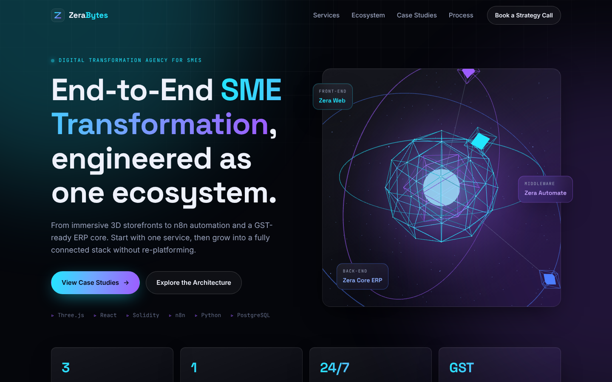

# Zera Bytes — Portfolio Site

A dark, glassmorphism portfolio website for **Zera Bytes**, covering its three divisions: Zera Web & Experiences, Zera Automate and Zera Core ERP.

It's a static site with no build step and no dependencies to install. Three.js r128 is vendored in `assets/vendor/`.



## Run locally

```bash
python3 -m http.server 8080
```

Then open http://localhost:8080. Any static host works, including GitHub Pages, Netlify, Vercel and Cloudflare Pages.

## Structure

```
index.html              Page sections: hero, services, ecosystem, case studies, process, contact
assets/css/styles.css   Design tokens (colors, fonts) at the top in :root
assets/js/cases.js      Case-study data + built-in vector mockups  ← edit this
assets/js/main.js       Rendering, filters, scroll reveal, 3D hero (Three.js)
assets/vendor/          three.min.js (r128)
assets/img/             Put project screenshots / renders here
```

## Editing the portfolio

All case studies live in `assets/js/cases.js` (`window.CASE_STUDIES`). Each entry renders as a card and as a row in the "View as matrix" table.

- **Images:** set `image: "assets/img/your-file.jpg"` to replace the built-in vector mockup with a real screenshot or render. Use 16:10 or 16:9 at 1600px wide or more.
- **ROI figures:** the current numbers are **placeholders**. Replace them with verified, client-approved results before you publish.
- **New project:** copy an entry and set `filter` to `web`, `erp` or `auto` so the category filter picks it up.

## Before launch

- Wire the contact form in `index.html` (`.cta__form`) to a real endpoint, such as Formspree, an n8n webhook or your CRM. Right now it only shows a confirmation message.
- Replace the placeholder ROI metrics.
- Add real project imagery.
